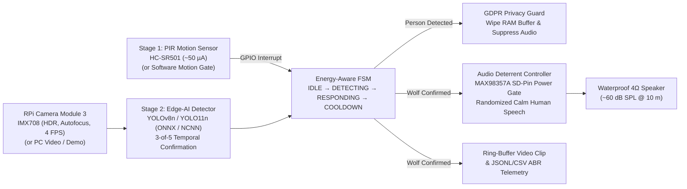
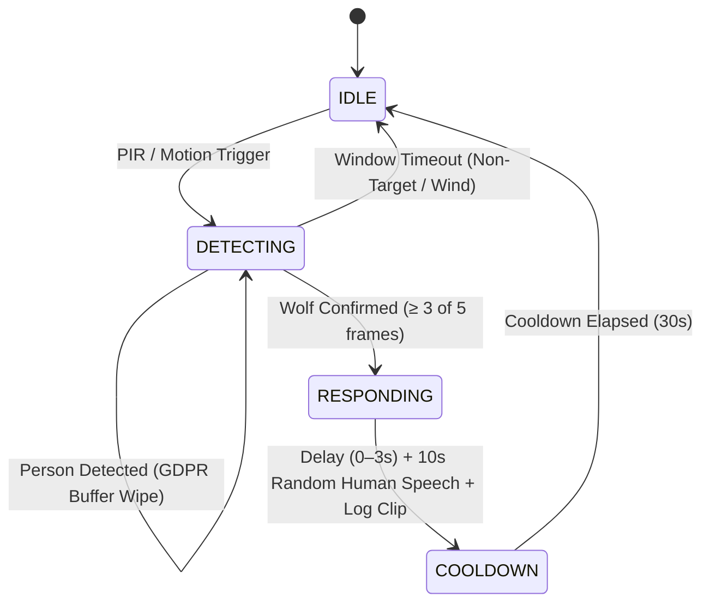
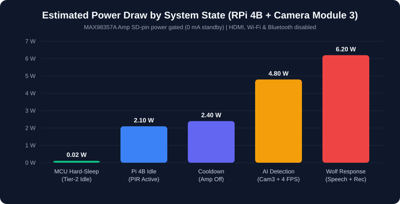
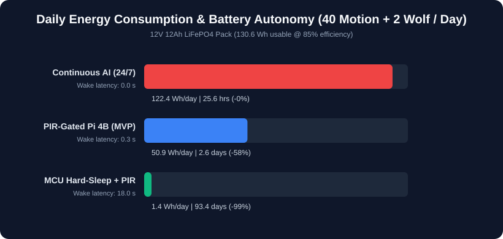

# WolfDet — Energy-Efficient Wolf Detection & Automated Human-Speech Deterrence System

**Ubiquitous Computing Project — Universität Siegen**

An energy-efficient, species-selective wildlife deterrence node built for **Raspberry Pi 4 Model B (4 GB)** and **Raspberry Pi Camera Module 3 (IMX708)**. Grounded in wildlife behavioral ecology (**Suraci et al., 2017**; **Zanette et al., 2023**), the system replaces indiscriminate motion-triggered noise with an edge-AI **Automated Behavioural Response (ABR)** pipeline that broadcasts randomized, calm human speech only when a wolf is visually confirmed — conserving battery life, minimizing non-target wildlife disturbance, and enforcing on-device GDPR privacy protection.

---

## Scientific Foundation

| Paper | Core Finding | Engineering Translation in WolfDet |
| :--- | :--- | :--- |
| **Zanette et al. (2023)**, *Current Biology* | Wildlife fears calm human vocalizations (*"human super predator"*) significantly more than lions, barking dogs, or gunshots (2× higher odds of fleeing, 40% faster abandonment). | Plays **8–14 randomized, calm human conversation clips** (~10 s, ~60 dB at 10 m) with no immediate repetition to prevent habituation. |
| **Suraci et al. (2017)**, *Methods in Ecology and Evolution* | Automated Behavioural Response (ABR) camera-speaker systems enable unattended field deterrence and behavioral evaluation, but motion-only triggers waste power on wind and non-target animals. | Adds a **2-stage Motion → Edge-AI Wolf Confirmation** pipeline (`M-of-N` temporal voting), **MAX98357A GPIO amplifier power gating** (0 mA standby), and **pre/post-playback video + JSONL telemetry** for ABR success metrics. |

---

## System Architecture



### Energy-Aware Finite State Machine



---

## Energy Efficiency Overview





Run the full quantitative power budget calculator at any time:

```bash
python scripts/power_budget.py
```

---

## Quickstart

### 1. Run the Built-in 3-Scenario Midterm Demo (Zero External Dependencies!)

Demonstrates all three core behaviors out of the box:
1. **Roe Deer (Non-Target)** → Detected, ignored, returns to low-power `IDLE`.
2. **Human Hiker (GDPR Guard)** → Frame buffer wiped immediately, audio & recording suppressed.
3. **Grey Wolf (Confirmed 3/5 frames)** → Triggers randomized calm human speech, saves ABR event log, enters `COOLDOWN`.

```bash
# PowerShell (Windows)
$env:PYTHONPATH="src"
python -m wolfdet.main --demo-scenarios

# Linux / macOS / Raspberry Pi
PYTHONPATH=src python3 -m wolfdet.main --demo-scenarios
```

*(Optional: Generate 8 local calm human-speech `.wav` demo clips first so the demo speaks out loud!)*

```bash
python scripts/generate_audio_exemplars.py
```

### 2. Run on a Real Wildlife Video or Webcam (PC / Laptop)

```bash
pip install -r requirements.txt
PYTHONPATH=src python -m wolfdet.main --source path/to/wildlife_video.mp4 --model yolov8n.pt --proxy-wolf
```

*(Use `--proxy-wolf` only when testing with stock COCO weights prior to custom wolf fine-tuning; with custom weights trained via `training/train_and_export.py`, omit `--proxy-wolf`.)*

### 3. Deploy on Raspberry Pi 4B + Camera Module 3

```bash
sudo apt update && sudo apt install -y python3-picamera2 python3-libcamera alsa-utils
pip install -r requirements-pi.txt
PYTHONPATH=src python3 -m wolfdet.main --pi --model models/wolfdet_yolov8n_ncnn_model
```

### 4. Run Automated Tests

```bash
python -m unittest discover -s tests -v
```

---

## Repository Layout

```text
Wolf-detection-2/
├── config/settings.yaml             # Master thresholds, delays, GPIO pins & power model
├── src/wolfdet/
│   ├── main.py                      # CLI entrypoint (--demo-scenarios, --source, --pi)
│   ├── state_machine.py             # Energy-aware FSM + M-of-N voting + GDPR guard
│   ├── motion/                      # HAL: HC-SR501 GPIO PIR + Software/Mock motion triggers
│   ├── camera/                      # HAL: RPi Camera Module 3 (picamera2), OpenCV & Demo camera
│   ├── detection/                   # HAL: YOLOv8n/ONNX/NCNN detector & Scenario mock
│   ├── audio/deterrent.py           # Anti-habituation random speech pool + MAX98357A SD gating
│   ├── recorder/event_logger.py     # Pre-trigger ring buffer + JSONL/CSV ABR event logger
│   ├── power/energy_model.py        # Runtime energy tracker & field autonomy math
│   └── ui/hud.py                    # OpenCV live HUD overlay + headless CLI dashboard
├── training/                        # 5-class YOLO dataset schema & RPi 4 ONNX/NCNN export
├── scripts/                         # Power budget, SVG chart generator, audio gen, Pi 4 profiler
├── docs/
│   ├── MIDTERM_PRESENTATION.md      # 10-slide Midterm deck guide mapped to 20-pt grading rubric
│   ├── ARCHITECTURE_AND_ENERGY.md   # Deep-dive software/ML design & energy trade-off analysis
│   ├── HARDWARE_BOM_AND_WIRING.md   # Hardware BOM (€), GPIO pinout & IP65 outdoor enclosure
│   └── assets/                      # Vector SVG charts ready for presentation slides
└── tests/                           # Unit & end-to-end integration test suite
```

---

## Documentation Index

* **[Midterm Presentation Guide & Slide Script](docs/MIDTERM_PRESENTATION.md)** — Complete 10-slide structure mapped directly to the 20-point grading rubric + live demo checklist + Q&A prep.
* **[Architecture & Energy Analysis](docs/ARCHITECTURE_AND_ENERGY.md)** — HAL design, Wolf-vs-Dog ML pipeline, and quantitative power budget calculations.
* **[Hardware BOM & GPIO Wiring](docs/HARDWARE_BOM_AND_WIRING.md)** — Exact parts list (EUR) for Raspberry Pi 4B + Camera Module 3, wiring table, IP65 outdoor housing, and night-vision trade-offs.
